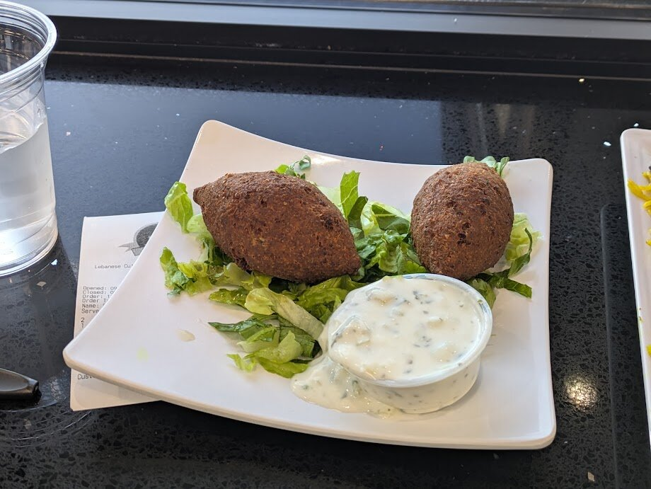
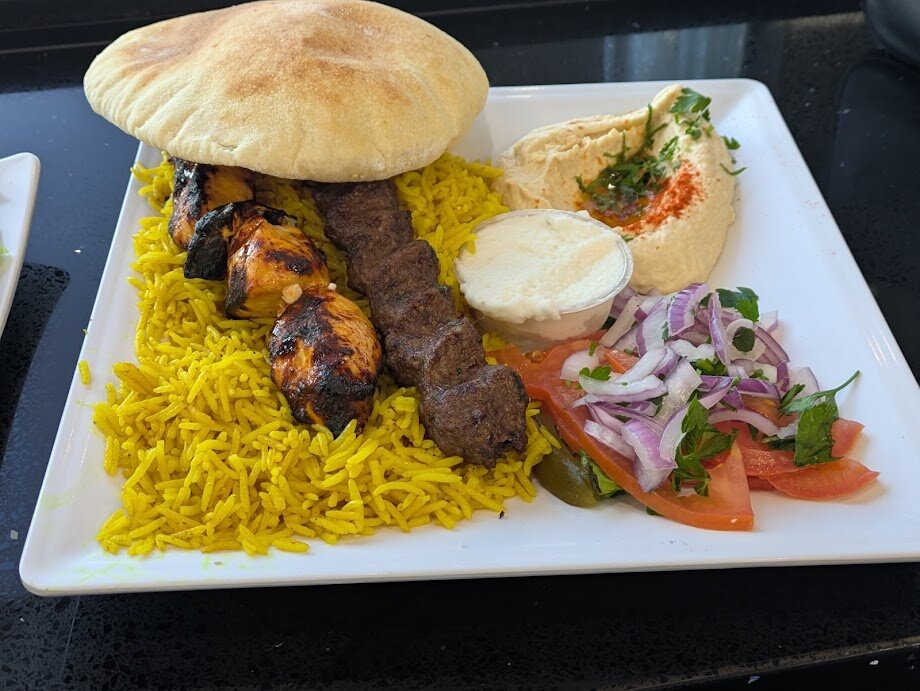

## Fried Kibbeh

> A classic combination of lamb, beef and bulgur wheat shell, stuffed with a filling of precooked ground beef, mixed with diced onion, pine seeds, and spices then fried to a perfect crunch. 1 pc ($2.99)

## Tawook & Kafta Plate

> 2 Skewers of meat grilled and served with rice pilaf, hummus, and fresh pita bread. ($18.99)

## Conclusion

First time trying Lebanese food and I loved it.