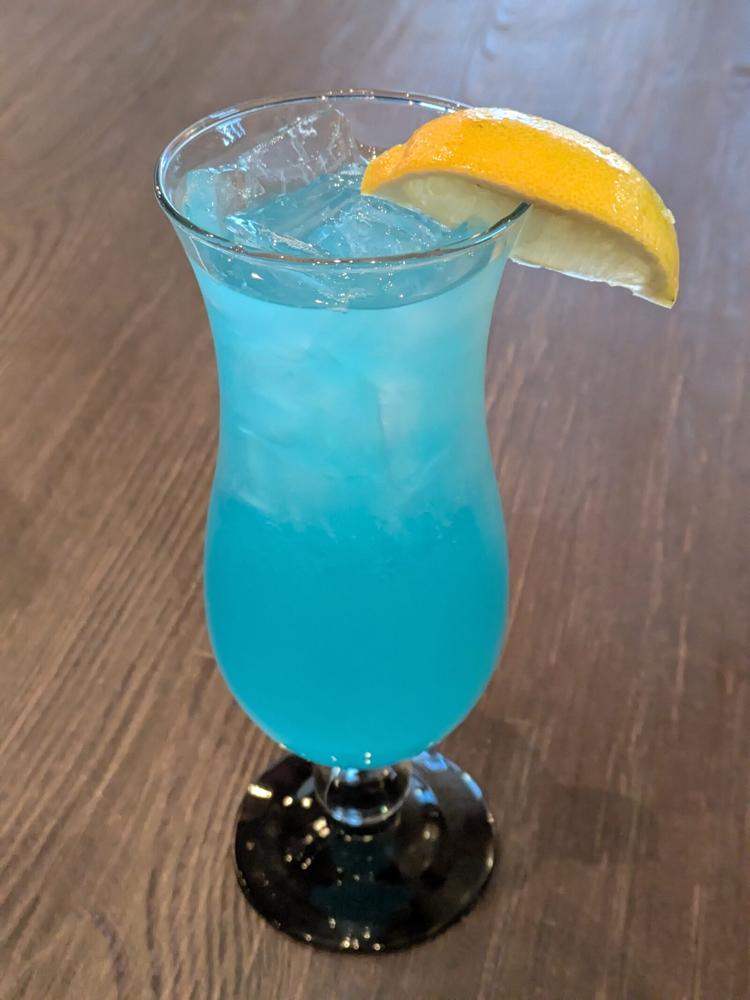
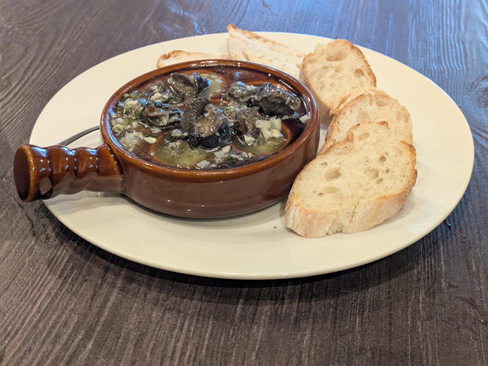
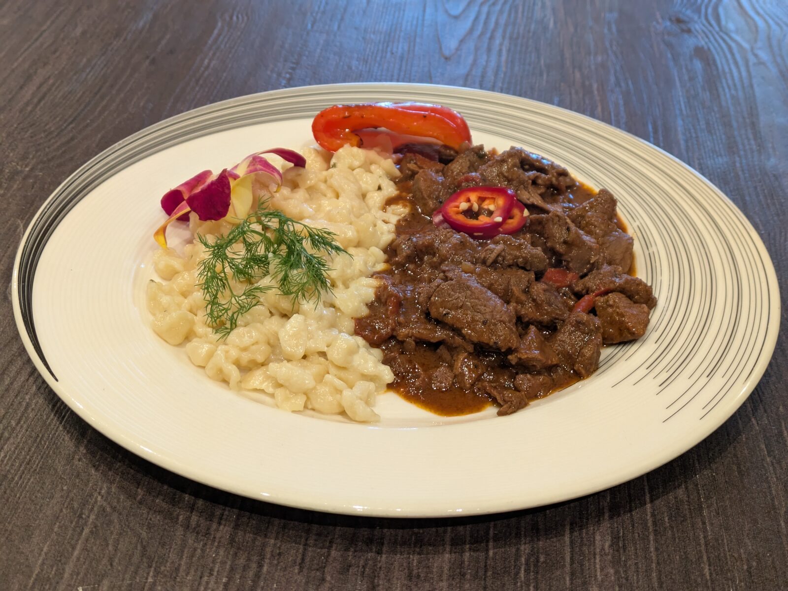
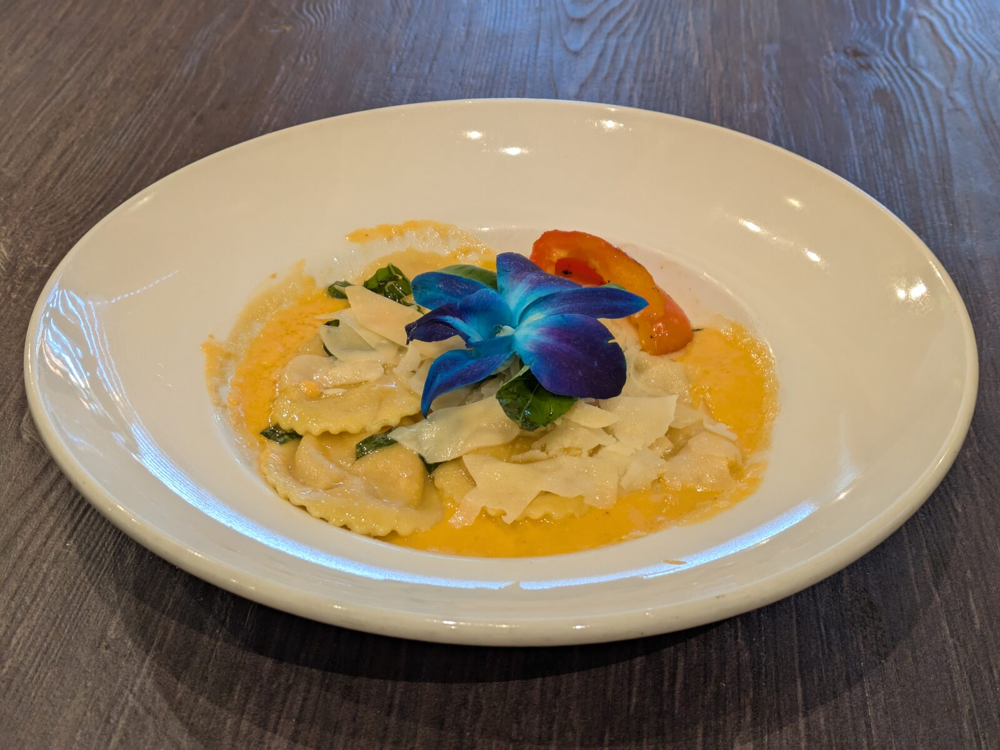

I was sold as soon as I saw that Google Maps listed it as an "Eclectic restaurant". 

## Hungarian Soda

Very sweet. Reminds me of a dirty soda. 

## Escargot

> Snails sautéed in decadent French garlic butter. ($12)

First time having escargot and I don't know what I expected. It had the same texture as the sea snails I had in Taiwan. It didn't really have any flavor. It felt like a carrier for extreme vampire-repellent garlic butter. 

## Goulash with Spätzle

> **Hungarian Tenderloin Goulash.** Chef Imi's legendary goulash, rich and hearty. ($32)

I didn't think I liked spätzle from the previous times I've had it, but this changed my mind. It was just the right bouncy texture and had a faint flavor to it (probably butter) that complemented the goulash. 

The goulash was delicious. The flavor was spot on and the meat had just the right texture - not too firm, but not mushy either. 

## Ravioli

> **Lobster Ravioli.** Ravioli stuffed with lobster meat, served over lobster sauce, topped with Parmesan. ($34)

## Conclusion

I'd definitely recommend this restaurant, especially if you're heading up to Tuacahn for a show. 