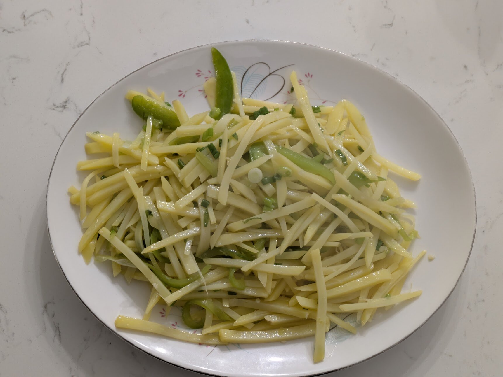

## Ingredients

- 2 medium potatoes
- 1 tsp Sichuan peppercorns
- 4 dried red chilies (朝天椒 or chiles de árbol)
- 2 cloves garlic
- 1 scallion
- 3 tbsp neutral oil
- 1 ½ tbsp Chinkiang black vinegar
- ½ tsp salt
- ¼ tsp sugar
- Pinch of MSG or chicken bouillon powder (optional)

## Steps

### Mise en place

1. Peel the 2 potatoes and cut them into thin matchsticks. Soak them in cold water, swishing and changing the water until it runs clear.
2. Pick the shiny black seeds and any stems out of the 1 tsp Sichuan peppercorns. Dry-toast them in the skillet over medium heat for 1–2 minutes, until they darken a shade and smell strongly floral. Tip them out, let them cool briefly, and grind them fine with a mortar and pestle.
3. Snip the 4 chilies into ½” pieces with scissors over a small bowl and shake out about half the seeds.
4. Mince the 2 cloves of garlic. Chop the scallion.
5. Split the 1 ½ tbsp vinegar into two small bowls.
6. Combine the ½ tsp salt, ¼ tsp sugar and pinch of MSG in a small bowl.
7. Drain the potatoes and pat them very dry so they stir-fry instead of steaming.

### Stir-fry (under 5 minutes)

1. Heat a 12-inch stainless skillet over medium-high for 2–3 minutes, until a drop of water skitters across the pan. Add the 3 tbsp of oil and let it shimmer.
2. Lower the heat to medium. Fry the chilies for about 20 seconds, until they darken a shade but don't blacken. Add the garlic and stir for about 10 seconds, until fragrant.
3. Turn the heat to medium-high and add the potatoes right away. Keep them moving for about 2 minutes. In the first minute, pour the first bowl of vinegar down the hot side of the pan so it sizzles before it reaches the potatoes.
4. Add the salt mixture and the second bowl of vinegar. Stir until the potatoes are translucent but still crunchy, about 30 seconds more.
5. Take the pan off the heat, toss in the ground Sichuan pepper and scallion, and serve with rice.

## Notes

The 10/18/26 batch was cooked in the nonstick alongside fish-fragrant pork, with no dried chilies and ½ green bell pepper for color. The photo is from this batch. It was pretty good, but bland beyond the salt, and the Sichuan peppercorn didn't come through. The vinegar was 工研烏醋 (Taiwanese black vinegar), which is milder, sweeter and fruitier than Chinkiang, and the peppercorns had been in the drawer long enough to go stale. Sichuan peppercorns lose their aroma within 6 months to a year of opening. Crush one to test: fresh ones smell bright and citrusy and make your tongue tingle.

The 11/1/26 batch followed the recipe above. It was better, but still lacked savory flavor, and some potatoes stuck to the pan. Next time, increase the salt to ¾ tsp and use ¼ tsp MSG instead of a pinch (or ½ tsp chicken bouillon powder with slightly less salt). To cut down on sticking, blanch the rinsed potatoes in boiling water for 20–30 seconds, cool them under cold water, dry them in a salad spinner, and turn the heat to high when the potatoes go in. Or use the nonstick with 2 tbsp oil.
