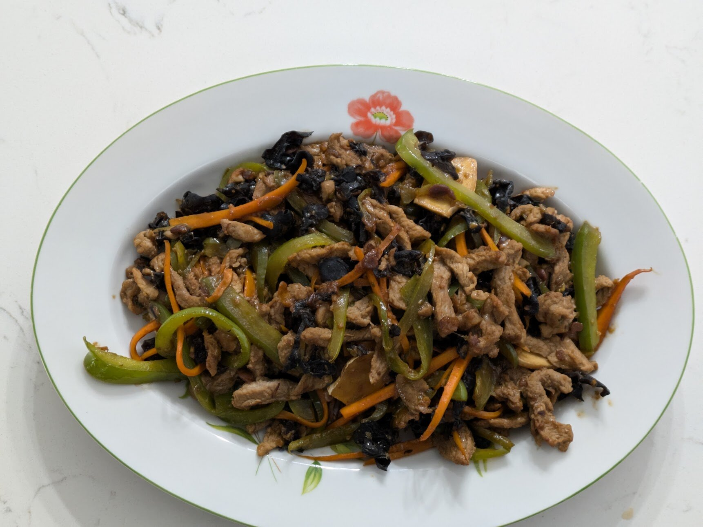

## Ingredients

### Pork

- 1 lb pork tenderloin
- 1 ½ tsp light soy sauce
- 1 ½ tbsp Shaoxing wine
- 1 ½ tsp cornstarch
- 1 ½ tbsp water
- Drizzle of neutral oil

### Sauce

- 2 ½ tbsp sugar
- 2 ½ tbsp Chinkiang black vinegar
- 1 ½ tbsp light soy sauce
- 1 ½ tsp cornstarch
- 5 tbsp water

### Stir-fry

- ½ oz dried wood ear mushrooms
- 1 medium carrot (or 2 small)
- 1 cup canned bamboo shoots
- 10 cloves garlic
- 1 ½ tbsp minced ginger
- 3 scallions
- 2 tbsp minced Sichuan pickled chilies (泡椒), or chopped salted chilies (剁椒)
- 1 ½ tbsp Taiwanese 豆瓣醬 (狀元 brand)
- 4 tbsp neutral oil

## Steps

### Soak wood ear (15 minutes)

1. Soak the ½ oz of wood ear in hot water for about 15 minutes.

### Mise en place

1. If the 1 lb of pork has thawed completely, put it in the freezer for about 15 minutes while you prep, so it's firm enough to slice.
2. Stir together the 2 ½ tbsp sugar, 2 ½ tbsp vinegar, 1 ½ tbsp soy sauce, 1 ½ tsp cornstarch and 5 tbsp water in a small bowl.
3. Trim any hard bits off the wood ear and slice it into thin strips.
4. Julienne the 1 medium carrot.
5. Rinse the 1 cup of bamboo shoots, blanch them in boiling water for 1 minute to remove the canned taste, and julienne them.
6. Mince the 10 cloves of garlic and 1 ½ tbsp of ginger.
7. Taste a sliver of the pickled chilies, and scrape out some seeds if they're very hot. Mince them almost to a paste until you have 2 tbsp.
8. Chop the 3 scallions, keeping the whites and greens separate.
9. Slice the pork into strips about ⅛” thick and 2” long. Toss with the 1 ½ tsp soy sauce, 1 ½ tbsp Shaoxing wine, 1 ½ tsp cornstarch, 1 ½ tbsp water and a drizzle of oil.

### Sear pork

1. Heat a 12-inch stainless skillet over medium-high for 2–3 minutes, until a drop of water skitters across the pan. Add 1 tbsp of the oil and let it shimmer.
2. Add a third of the pork in a single layer and leave it alone for 20–30 seconds so it releases, then stir until it just turns white, about 1 minute more. Move it to a plate.
3. Repeat twice more, with 1 tbsp of oil per batch.

### Stir-fry (under 5 minutes)

1. Lower the heat to medium and add the last 1 tbsp of oil. Fry the pickled chilies and 1 ½ tbsp 豆瓣醬 for 30–45 seconds, until the oil turns red. Add the garlic, ginger and scallion whites and stir until fragrant.
2. Turn the heat back to medium-high and add the wood ear, bamboo shoots and carrot. Stir-fry for 1–2 minutes, until the carrot is tender-crisp.
3. Return the pork, stir the sauce, and pour it in. Turn the heat down a notch and fold for 45 seconds to 1 minute, until glossy and thickened.
4. Top with the scallion greens and serve with rice.

## Notes

The 10/18/26 batch was cooked in the 12-inch stainless alongside the [hot and sour potatoes](), with green bell pepper instead of bamboo shoots and no pickled chilies. The photo is from this batch. It was pretty good, but it was missing the pickled chili flavor. The vinegar was 工研烏醋 (Taiwanese black vinegar), which is milder, sweeter and fruitier than Chinkiang.

The 11/2/26 batch followed the recipe above. The sauce was better and more restaurant-like. The pork had thawed completely in the fridge overnight and needed about 15 minutes back in the freezer before slicing. It tasted meatier and a bit raw, left reddish liquid in the marinade, and stuck to the stainless, leaving a crust that got deglazed with the sauce. Even in 3 batches, a full pound made the skillet busy, and there could have been a little more sauce.

Next time, try 10 oz of pork so the pan is less crowded, and scale everything down to about ⅝, except make about 20% more sauce than a straight scale-down. For 10 oz that's 1 ¾ tbsp sugar, 1 ¾ tbsp vinegar, 1 tbsp + ½ tsp soy sauce, 1 ¼ tsp cornstarch and 3 ½ tbsp water. For 1 lb it's 3 tbsp sugar, 3 tbsp vinegar, 1 tbsp + 2 tsp soy sauce, 2 tsp cornstarch and 6 tbsp water. Move the pork from the freezer to the fridge the morning of, not the night before, and slice it while it's still firm in the center. Pat the strips dry, use ginger-scallion water (蔥薑水: water with a few ginger slices and a scallion squeezed in it) instead of plain water in the marinade, add a pinch of white pepper, and stir in the oil just before the pork goes in the pan.

Both batches used 狀元 (Master) Taiwanese 豆瓣醬, a mild, slightly sweet soybean paste with no chili, not Pixian doubanjiang. On the 11/2 batch the pickled chilies supplied most of the heat. Next time, chop the doubanjiang fine so there are no whole beans, and try Pixian (鵑城牌 or 丹丹) to compare. If sticking with 狀元, cut the sugar back a bit, since the paste already has some.
