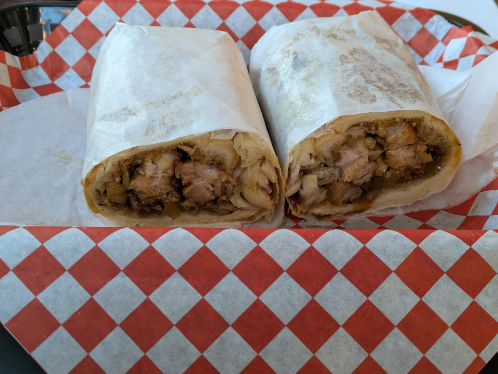
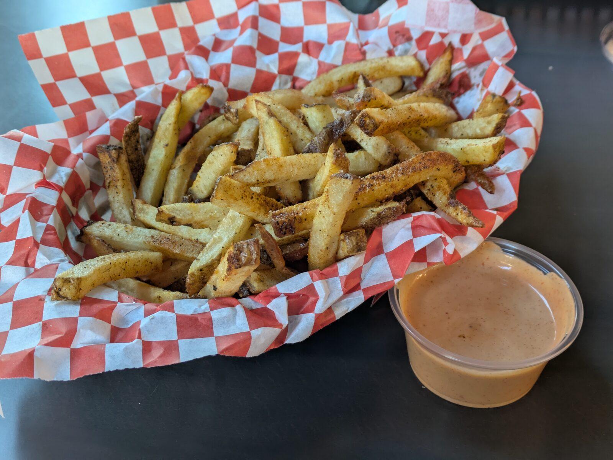

## Cider Braised Pork Belly

> Pork belly braised in cider, dunked in an apple cider glaze, and given absolutely no opportunity to behave itself. We're layering all that rich, savory pork belly with apple and fig mostarda for a sweet and tangy punch, then adding pickled apples for another hit of acidity and crunch. Radicchio & cabbage slaw tossed in honey mustard dressing brings a little bitterness, a little sweetness, and some much needed texture to balance the whole operation. All piled into a hoagie roll. November 2026 monthly special ($16)

## Korean Fried Chicken

> Crispy don-gaseu chicken topped with sriracha chili crisp mayo, ginger-garlic gochujang sauce, crispy onions, fresh cilantro, and house-made kimchi bacon jam, served on a toasted ciabatta with crisp cucumber. ($15)

My friend ordered this one. No picture.

## Hand Cut Fries

> Plain or Cajun (+$1) ($6.50)

## Conclusion

I came here a few years ago for the breakfast sandwiches. They were phenomenal, five stars, and back then I would have given the restaurant five stars too. This time the pork belly special was a three, but the Korean fried chicken and the Cajun fries held up. Four stars now.
