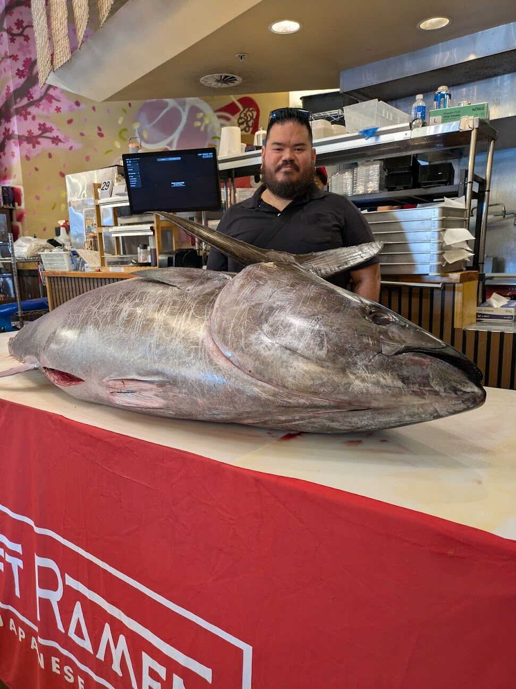

I couldn't resist the call of the ~~wild~~ fish.

At $133.16 per person, this is no regular event. But it sounded way too intriguing for me to pass up. With high hopes and an empty stomach, I attended alone. 

## The Fish

Frankly, I had no idea what the size of a tuna actually was. I suppose if you're feeding 80 people, it's going to be large. At around 200 lbs, it was a sight to behold. The fish was described as super fresh, having only been harvested four days prior from a tuna farm in the Gulf of Mexico, according to the owner. It was flown to the SLC airport — presumably chilled, but not frozen, though the organizer didn't elaborate. The tail was cut off prior to being presented, but otherwise appeared whole. 

## The Show
Part of the benefit of going alone was that there were seats right up against the tuna (the splash zone) to watch the show. The master carver flown in from Japan methodically cut apart the tuna into its component parts, starting with the head, then the belly, then the rest of the body. The head was kept aside as an auction item at the end of the show, as were the two pieces of meat by the collarbone (the kama, supposedly really prized cuts). After the belly was cut, the store owner brought around the piece of otoro — it must've been hundreds of dollars worth if you were to order that much otoro at a sushi restaurant — for attendees to look closely at the well marbled piece of tuna. The rest of the show was less exciting: the carver slicing through the bright red flesh like a hot knife through butter with his carving knife. 

I've been particularly interested in the ethos behind the Japanese phrase "Itadakimasu", especially the part where one thanks the sacrifice of the animal to provide their flesh as sustenance. In the modern era, we've become increasingly distanced from the source of the food that we eat ("We don't kill animals. That's much too cruel. We buy it ethically in packages from the supermarket"). My curiosity for how things work has extended to the sphere of how food gets from its rawest and most primitive form to the refined version that gets in my belly. This show got me right up close and personal to see what exactly goes into going from a fresh fish to one of my favorite dishes: otoro.

## The Food
Unfortunately, it wasn't until this moment that I realized that fresh fish doesn't have the flavor of raw fish at sushi restaurants. The fish served as sashimi and on nigiri there is usually days older, and at high-end places it's often aged on purpose, which gives it time to develop the familiar and beloved flavor. Farmed bluefin also tends to be milder than wild. All that to say, this tuna had very little flavor, but at least it didn't taste fishy. Given the 200 lb fish, it was functionally all you can eat tuna. The servers brought around rounds and rounds of the bright red cheaper cuts as sashimi, chutoro nigiri, tuna handrolls, and bowls of otoro. Despite its fatty tenderness, the otoro lacked the depth of flavor that I love so much. 

> “Lots of people have begun to understand that sushi has almost nothing to do with freshness. It’s all about the sweet spot during its decay.”
>
> -- Anthony Bourdain, [Smithsonian](https://www.smithsonianmag.com/arts-culture/anthony-bourdains-theory-foodie-revolution-180951848/)

There were also appetizers prior to the fish coming out, as the chefs in the back sliced up the large chunks the carver had cut. The appetizer consisted of some edamame, three small side dishes reminiscent of Korean banchan, some tempura vegetables, and a bowl of miso soup. Most of it was fine, with the exception of the miso that I didn't finish because I found it much too sweet. 

The final course of the meal was a refreshing citrusy panna cotta, which was delicious. 

## Conclusion
I had a good time. For me, this was an event worth attending exactly once — treated specifically as a spectacle and not as a dining experience.
