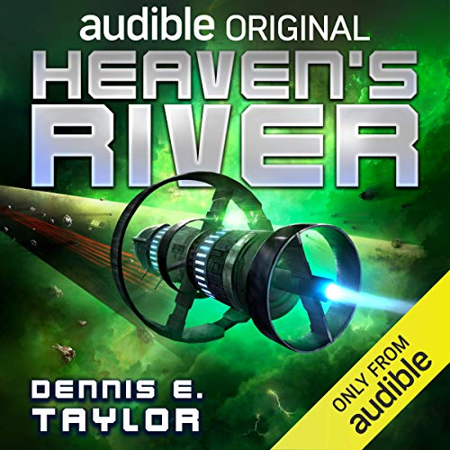

{: .book-cover}

The story was engaging, but the twists were easy to guess. Bob's sense of humor, sarcasm, and pop culture references started to wear on me by the end. The ending felt rushed, and <label class="spoiler"><input type="checkbox" aria-label="Show spoiler">the AI was a literal deus ex machina, making a decision that makes sense on the surface but feels unsatisfying.</label>

There were a few parts of the book that I found particularly interesting: the consequences of "replicative drift," the revelation about souls, and interspecies diplomacy (I'm counting the Bobs as their own "species").

Adding replicative drift to the series felt like a great way to inject more variety into the cast without bringing in characters beyond the Bob clones. It establishes the Bobiverse as its own "species" and society rather than just one individual with lots of nodes, which brings competing priorities, different worldviews, and different areas of technical expertise. I'm interested to see how this develops as the Bobs continue to propagate.

I found the in-universe explanation for souls to be an interesting plot point, and I think it sets up more interesting scenarios going forward. <label class="spoiler"><input type="checkbox" aria-label="Show spoiler">For example, if a Bob kept backups, he would effectively be not only immortal but invulnerable, because a restored backup <em>is</em> the same entity, thanks to whatever quantum mumbo-jumbo was used to make this definition work.</label>

As a big fan of the Three-Body Problem trilogy, especially its dark forest explanation for the Fermi Paradox, I find it hard to see how interspecies diplomatic relations don't break down eventually. While SCUT eliminates the FTL communication problem, the few experiences the Bobs have had with humans and the Pav have not ended well. One Bob (I can't remember who, maybe Garfield?) tells Bill that human-replicant relations tend to go in cycles and that they'll be on good terms again within 100 years. To me, it seems more helical: cyclical, but always spiraling toward all-out war and mutual annihilation.

Overall, I enjoyed listening to this book with Ray Porter's narration. The first-person POV made it easy to follow and kept the plot moving quickly. Between the interesting ideas above and the fun Quinlan world-building, it was an enjoyable ride.
