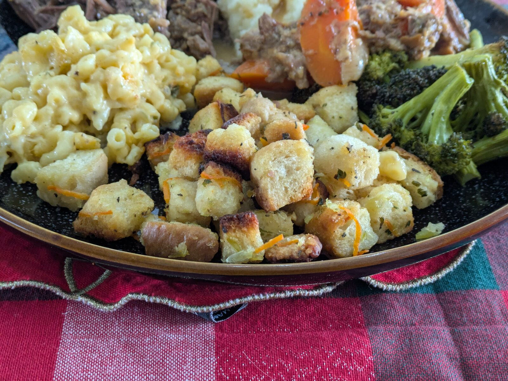
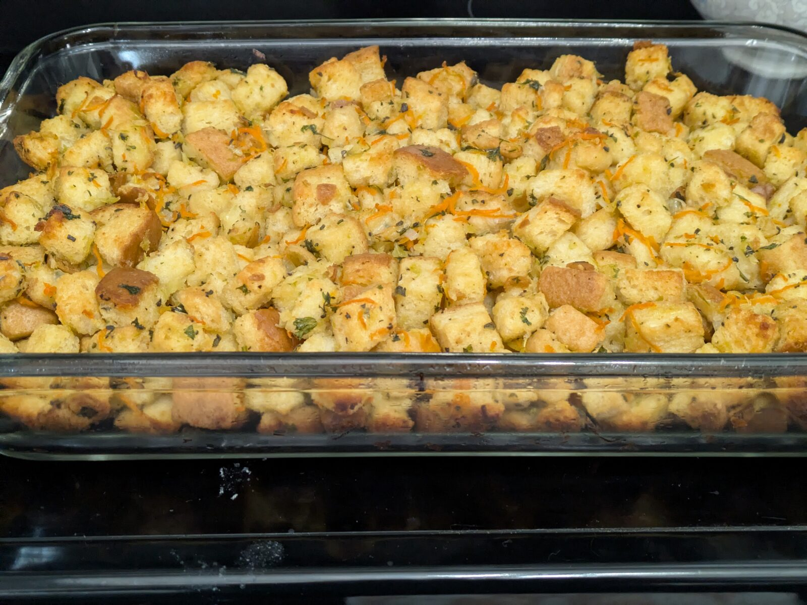

<section class="recipe-version" id="last-cooked" markdown="1">

Last cooked · 11/26/26

## Ingredients

- 1 loaf white bread
- ½ yellow onion
- 1 medium carrot
- 4 stalks celery
- ⅔ cup duck fat, plus a little for the pan
- ¼ cup fresh parsley
- 3 tsp fresh sage
- ½ tsp kosher salt
- ½ tsp truffle salt
- ½ tsp black pepper
- About 1 ½ cups low-sodium chicken broth

## Steps

### Pre-preparations (days before)

1. Cut and dry bread cubes. Cut the loaf into ½” cubes and spread them on a baking sheet. Either leave them out for 2-3 days or dry them in a 200 ℉ oven for 1-2 hours, stirring now and then.

### Mise en place

1. Finely dice the ½ yellow onion.
2. Pulse the 4 stalks of celery in a food processor until minced.
3. Mince the ¼ cup fresh parsley.
4. Mince the 3 tsp fresh sage.
5. Grate the medium carrot and squeeze inside paper towel.
6. Measure out ⅔ cup duck fat, ½ tsp kosher salt, ½ tsp truffle salt, and ½ tsp black pepper.

### Cook vegetables

1. In a large pan melt the ⅔ cup duck fat on medium heat.
2. Cook the onion and celery for 6-8 minutes, until soft.
3. Stir in the carrot and give it 2 more minutes.
4. Take off the heat, stir in the sage and let it wilt for a minute.

### Mix it up

1. Add the dried bread cubes and parsley to a large mixing bowl and combine.
2. Pour the cooked vegetables and all the duck fat into the bowl and combine.
3. Sprinkle in the ½ tsp truffle salt, ½ tsp kosher salt, and ½ tsp black pepper, then fold to mix.
4. Drizzle in about half the broth while stirring. Go slowly, because pouring it all in at once leaves soggy spots. I've found that the amount of broth needed can vary.
5. Keep adding broth a little at a time until the bread is damp all the way through but not wet.
6. Taste and adjust the salt and pepper.

### Add to casserole dish

1. Grease a 9x13 inch pan or similar size casserole dish with duck fat. Pour in the stuffing and cover with tinfoil.

### Bake (total 45 minutes)

1. Bake at 350 ℉ for 30 minutes.
2. Uncover and bake for another 10-15 minutes.

</section>

<section class="recipe-version" id="next-try" markdown="1">

Next try · untested

## Ingredients

- 1 loaf white bread
- ½ yellow onion
- 1 medium carrot
- 4 stalks celery
- ⅔ cup duck fat, plus a little for the pan
- ¼ cup fresh parsley
- 3 tsp fresh sage
- ½ tsp kosher salt
- ½ tsp truffle salt, for finishing
- ½ tsp black pepper
- About 2 cups low-sodium chicken broth

## Steps

### Pre-preparations (days before)

1. Cut and dry bread cubes. Cut the loaf into ½” cubes and spread them on a baking sheet. Either leave them out for 2-3 days or dry them in a 200 ℉ oven for 1-2 hours, stirring now and then.

### Mise en place

1. Finely dice the ½ yellow onion.
2. Pulse the 4 stalks of celery in a food processor until minced.
3. Mince the ¼ cup fresh parsley.
4. Mince the 3 tsp fresh sage.
5. Grate the medium carrot and squeeze inside paper towel.
6. Measure out ⅔ cup duck fat, ½ tsp kosher salt, and ½ tsp black pepper. Set aside ½ tsp truffle salt for after baking.

### Cook vegetables

1. In a large pan melt the ⅔ cup duck fat on medium heat.
2. Cook the onion and celery for 6-8 minutes, until soft.
3. Stir in the carrot and give it 2 more minutes.
4. Take off the heat, stir in the sage and let it wilt for a minute.

### Mix it up

1. Add the dried bread cubes and parsley to a large mixing bowl and combine.
2. Pour the cooked vegetables and all the duck fat into the bowl and combine.
3. Sprinkle in the ½ tsp kosher salt and ½ tsp black pepper, then fold to mix.
4. Drizzle in about half the broth while stirring. Go slowly, because pouring it all in at once leaves soggy spots. I've found that the amount of broth needed can vary.
5. Keep adding broth a little at a time until the bread is damp all the way through but not wet.
6. Taste and adjust the salt and pepper.

### Add to casserole dish

1. Grease a 9x13 inch pan or similar size casserole dish with duck fat. Pour in the stuffing and cover with tinfoil.

### Bake (total 45 minutes)

1. Bake at 350 ℉ for 30 minutes.
2. Uncover and bake for another 10-15 minutes.
3. Sprinkle the ½ tsp truffle salt over the top as soon as it comes out of the oven.

</section>

## Make ahead

Assemble the stuffing 1-2 days ahead and keep it unbaked in the fridge, covered in the casserole dish or in a ziplock bag. The rest gives the flavors time to come together. The duck fat sets firm in the fridge, so let it sit on the counter for 30 minutes, then follow the Bake step.

## Notes

The 11/26/26 batch was assembled ahead, kept in the fridge and baked on Thanksgiving. It turned out good. It ran a little dry on broth, the opposite of the batch before, which was soaked. The truffle salt couldn't be smelled at all once it came out of the oven, either from sitting in the fridge or from the bake.

The next try uses about 2 cups of broth and sprinkles the truffle salt on top right as it comes out of the oven.

Adapted from [Tastes Better From Scratch](https://tastesbetterfromscratch.com/stuffing/).
