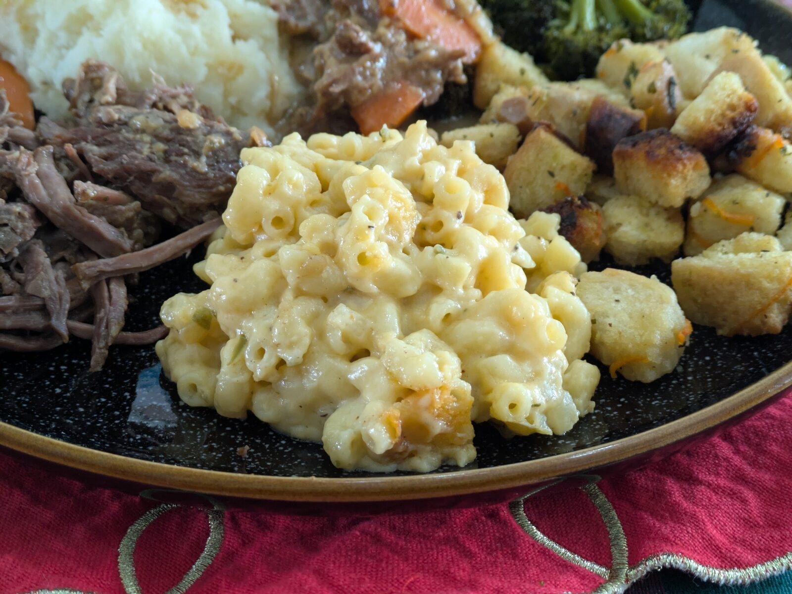
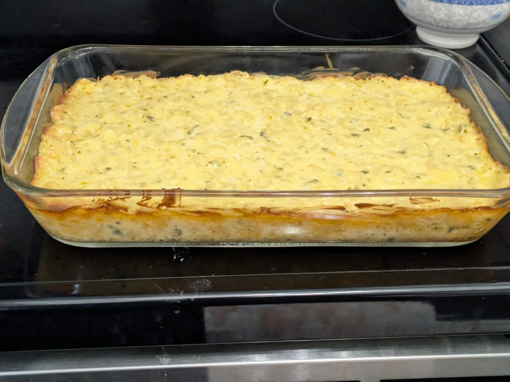

<section class="recipe-version" id="last-cooked" markdown="1">

Last cooked · 11/26/26

## Ingredients

- ½ lb short pasta, like elbow macaroni
- 2 tbsp butter
- 2 tbsp all-purpose flour
- 1 ½ cups milk
- ¾ cup half and half
- 1 ½ tsp cornstarch
- ½ tsp dijon mustard
- 1 ½ tsp chicken bouillon paste or powder
- ¼ tsp onion powder
- ½ tsp garlic powder
- ½ tsp dried parsley flakes
- ½ tsp salt
- ¼ tsp ground black pepper
- 2 cups freshly grated sharp cheddar cheese
- ½ cup freshly grated parmesan cheese
- ½ yellow onion
- ¼ cup pickled jalapeño

## Steps

### Mise en place

1. Grate the 2 cups sharp cheddar and ½ cup parmesan. Set them aside to come to room temperature.
2. Dice the ½ yellow onion.
3. Mince the ¼ cup pickled jalapeño.
4. Combine the ½ tsp dijon mustard, 1 ½ tsp chicken bouillon, ¼ tsp onion powder, ½ tsp garlic powder, ½ tsp dried parsley, ½ tsp salt and ¼ tsp black pepper.
5. Whisk the 1 ½ tsp cornstarch into the ¾ cup half and half until smooth.
6. Measure out 1 ½ cups of milk.

### Boil pasta

1. Boil the ½ lb pasta according to the package instructions. Drain.

### Make the cheese sauce

1. In a skillet, melt the 2 tbsp butter and sauté the onion until soft.
2. Whisk in the 2 tbsp flour. Cook, stirring, for 2 minutes.
3. Reduce the heat to low and gradually whisk in the 1 ½ cups milk.
4. Gradually add the half and half and cornstarch, then the seasoning mixture.
5. Cook, stirring well, for a few more minutes, just until the sauce begins to thicken.
6. Remove from the heat and stir in the cheeses. Taste and add more seasoning if needed.

### Assemble

1. Stir together the cheese sauce, pasta and jalapeño.
2. Pour into a 9x13 inch glass baking dish.

### Bake (20 minutes)

1. Bake at 350 ℉ for 20 minutes, until bubbly.
2. (Optional) Turn on the broiler for the last couple of minutes to crisp the top.

</section>

<section class="recipe-version" id="next-try" markdown="1">

Next try · untested

## Ingredients

- ½ lb short pasta, like elbow macaroni
- 2 tbsp butter
- 2 tbsp all-purpose flour
- 1 ½ cups milk
- ¾ cup half and half
- 1 ½ tsp cornstarch
- 1 ½ tsp chicken bouillon paste or powder
- ¼ tsp onion powder
- ½ tsp garlic powder
- ½ tsp dried parsley flakes
- ½ tsp salt
- ¼ tsp ground black pepper
- 6 oz (170 g) sharp cheddar cheese
- 4 oz (115 g) gruyère cheese
- ½ yellow onion
- 1 oz (28 g) pickled jalapeño

## Steps

### Mise en place

1. Grate the 6 oz sharp cheddar and 4 oz gruyère. Set them aside to come to room temperature.
2. Dice the ½ yellow onion.
3. Mince the 1 oz pickled jalapeño.
4. Combine the 1 ½ tsp chicken bouillon, ¼ tsp onion powder, ½ tsp garlic powder, ½ tsp dried parsley, ½ tsp salt and ¼ tsp black pepper.
5. Whisk the 1 ½ tsp cornstarch into the ¾ cup half and half until smooth.
6. Measure out 1 ½ cups of milk.

### Boil pasta

1. Boil the ½ lb pasta according to the package instructions. Drain.

### Make the cheese sauce

1. In a skillet, melt the 2 tbsp butter and sauté the onion until soft.
2. Whisk in the 2 tbsp flour. Cook, stirring, for 2 minutes.
3. Reduce the heat to low and gradually whisk in the 1 ½ cups milk.
4. Gradually add the half and half and cornstarch, then the seasoning mixture.
5. Cook, stirring well, for a few more minutes, just until the sauce begins to thicken.
6. Remove from the heat and stir in the cheeses. Taste and add more seasoning if needed.

### Assemble

1. Stir together the cheese sauce, pasta and jalapeño.
2. Pour into a 9x13 inch glass baking dish.

### Bake (20 minutes)

1. Bake at 350 ℉ for 20 minutes, until bubbly.
2. (Optional) Turn on the broiler for the last couple of minutes to crisp the top.

</section>

## Make ahead

Make the sauce and cook the pasta 1-2 days ahead. Store them separately in the fridge until you're ready to assemble and bake.

## Notes

The 11/26/26 batch used dijon and elbow macaroni, with the parmesan stirred into the sauce instead of sprinkled on top. It turned out great. A 9x13 inch glass dish gives a thinner layer than the 8x8 the original recipe calls for.

The next try removes the dijon mustard since the acid from the jalapeño should accomplish the same thing. It also swaps the parmesan for gruyère and measures the cheese by weight: 10 oz in all, about what 2 cups of cheddar and ½ cup of parmesan weigh.

Adapted from [Tastes Better From Scratch](https://tastesbetterfromscratch.com/gourmet-baked-mac-cheese-bacon/).
