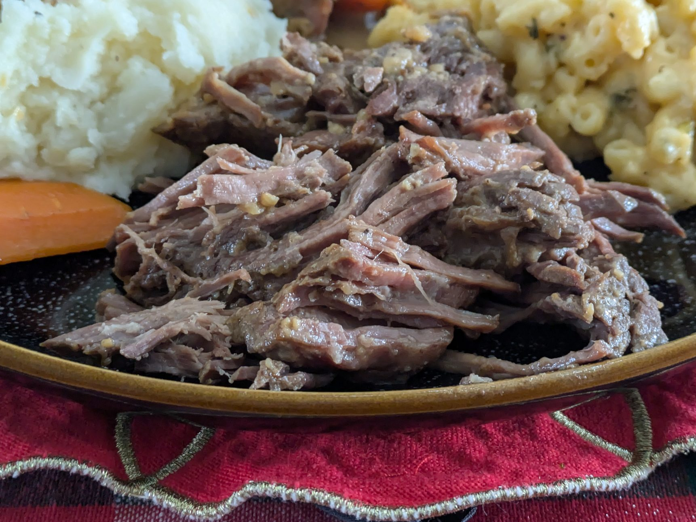

<section class="recipe-version" id="last-cooked" markdown="1">

Last cooked · 11/26/26

## Ingredients

### Roast

- 3 lb beef chuck roast
- Salt and black pepper
- 3 tbsp oil
- Non-stick cooking spray

### Sauce

- 2 cups cold milk
- 4 tbsp cornstarch
- 3 tbsp butter
- ¼ cup dried onion flakes (14 g)
- 2 tbsp beef bouillon granules (30 g)
- 2 tsp chicken bouillon paste, or 1 cube
- 1 tsp salt
- ¾ tsp onion powder
- ½ tsp garlic powder
- ½ tsp dried parsley flakes
- ⅜ tsp freshly ground black pepper
- ⅛ tsp celery seed
- ⅛ tsp paprika

### Vegetables

- Carrots
- Yellow onions

### Gravy

- Cornstarch and cold water, for a slurry

## Steps

### Mise en place

1. Cut the carrots and onions into chunks.
2. Measure the 2 cups cold milk in a measuring cup and whisk in the 4 tbsp cornstarch.
3. Combine the ¼ cup dried onion flakes, 2 tbsp beef bouillon granules, 2 tsp chicken bouillon paste, 1 tsp salt, ¾ tsp onion powder, ½ tsp garlic powder, ½ tsp dried parsley, ⅜ tsp black pepper, ⅛ tsp celery seed and ⅛ tsp paprika.
4. Season the 3 lb roast generously with salt and pepper on all sides.

### Sear

1. Heat a large stainless skillet over medium-high heat. Once the skillet is hot, add the 3 tbsp oil.
2. Once the oil is hot, add the meat. Sear for a few minutes on each side, until all sides are well browned.
3. Lightly grease a 6 qt slow cooker with non-stick cooking spray. Place the roast whole in the bottom.

### Make the sauce in the skillet

1. Turn the heat down to medium, leaving the oil in the skillet. Add the 3 tbsp butter and let it start melting.
2. Pour in the milk and cornstarch and scrape up the browned bits.
3. Add the dry sauce mix.
4. Bring to a boil, stirring frequently. Once boiling, simmer for 30 more seconds to thicken.
5. Pour the sauce over the meat.

### Slow cook (about 11 hours)

1. Cover and cook on LOW, starting from a cold crock.
2. At 9 hours, add the carrots and onions. Tuck them down along the walls of the crock, and lift the roast to slide some underneath.
3. Check the roast by poking it with a fork. It should shred easily. It was done by 10 hours.
4. If the carrots are still hard once the roast is done, move the roast to a platter and turn the slow cooker to HIGH until they're tender.

### Make gravy

1. Pour the vegetables and juices through a strainer into a saucepan. Move the vegetables to the platter.
2. Taste the juices. If they're too salty, stir in water.
3. Bring the juices to a simmer over medium heat.
4. Stir together some cornstarch and cold water. Pour it in a little at a time, stirring, until the gravy is as thick as you like.

</section>

<section class="recipe-version" id="next-try" markdown="1">

Next try · untested

## Ingredients

### Roast

- 3–5 lb beef chuck roast
- Salt and black pepper
- 3 tbsp oil
- Non-stick cooking spray

### Sauce

- 2 cups cold milk
- 4 tbsp cornstarch
- 3 tbsp butter
- ¼ cup dried onion flakes (14 g)
- 2 tbsp beef bouillon granules (30 g)
- 2 tsp chicken bouillon paste, or 1 cube
- 1 tsp salt
- ¾ tsp onion powder
- ½ tsp garlic powder
- ½ tsp dried parsley flakes
- ⅜ tsp freshly ground black pepper
- ⅛ tsp celery seed
- 1 cup water

### Vegetables

- Carrots
- Yellow onions
- Cremini mushrooms, small ones whole, large ones halved

### Gravy

- Cornstarch and cold water, for a slurry

## Steps

### Mise en place

1. Cut the carrots and onions into chunks. Halve any large mushrooms.
2. Measure the 2 cups cold milk in a measuring cup and whisk in the 4 tbsp cornstarch.
3. Combine the ¼ cup dried onion flakes, 2 tbsp beef bouillon granules, 2 tsp chicken bouillon paste, 1 tsp salt, ¾ tsp onion powder, ½ tsp garlic powder, ½ tsp dried parsley, ⅜ tsp black pepper and ⅛ tsp celery seed.
4. Season the roast generously with salt on all sides. Hold off on the pepper.

### Sear

1. Heat a large stainless skillet over medium-high heat. Once the skillet is hot, add the 3 tbsp oil.
2. Once the oil is hot, add the meat. Sear for a few minutes on each side, until all sides are well browned.
3. Lightly grease a 6 qt slow cooker with non-stick cooking spray. Spread the carrots, onions and mushrooms over the bottom.
4. Season the seared roast with pepper on all sides and set it whole on top of the vegetables.

### Make the sauce in the skillet

1. Turn the heat down to medium, leaving the oil in the skillet. Add the 3 tbsp butter and let it start melting.
2. Pour in the milk and cornstarch and scrape up the browned bits.
3. Add the dry sauce mix.
4. Bring to a boil, stirring frequently. Once boiling, simmer for 30 more seconds to thicken.
5. Stir in the 1 cup water.
6. Pour the sauce over the meat and vegetables.

### Slow cook (8–10 hours)

1. Cover and cook on LOW, starting from a cold crock.
2. Start checking the roast at 8 hours by poking it with a fork. It should shred easily. If it's tough, cook longer.

### Make gravy

1. Move the roast to a platter.
2. Pour the vegetables and juices through a strainer into a saucepan. Move the vegetables to the platter, and pick out the beef pieces left in the strainer.
3. Taste the juices. If they're too salty, stir in water.
4. Bring the juices to a simmer over medium heat.
5. Mix up more cornstarch slurry than you think you'll need. Pour it in a little at a time, stirring, until the gravy is as thick as you like.

</section>

## Notes

The 11/8/26 batch used a 4 lb roast, which didn't fit whole in the 4 qt slow cooker and had to be cut in two. The carrots and onion cooked unevenly: some pieces were soft and some still crunchy, regardless of chunk size. The likely cause is the crowded crock plus the thick sauce leaving cool spots in the middle.

The 11/26/26 batch was for Thanksgiving. It used a roast just over 3 lb in a new 6 qt slow cooker, where it fit whole, though it filled the bottom. The roast was seared and the sauce made in the same skillet the night before, and the slow cooker started at 1 am from a cold crock. The roast was done by 10 hours, maybe earlier. The carrots went in at 9 hours, and 1 ½ hours later some were still hard, so the roast came out and the vegetables finished on HIGH. The gravy was salty enough to need a lot of water, unmeasured, and came out a little thin because the slurry ran out. The fat was left in the gravy, and the strainer caught a lot of beef pieces along with the vegetables. Some of the seasoning came off on the pan and left spots where the sear didn't take.

The next try puts the vegetables in at the start, under the roast, and adds mushrooms. It salts the roast before searing and peppers it after. It thins the sauce with 1 cup water at the start, to help the vegetables stay covered and cook evenly and to cut the salt, instead of watering down the gravy at the end. It drops the ⅛ tsp paprika, which was too little to taste.

Adapted from [Tastes Better From Scratch](https://tastesbetterfromscratch.com/slow-cooker-pot-roast/).
